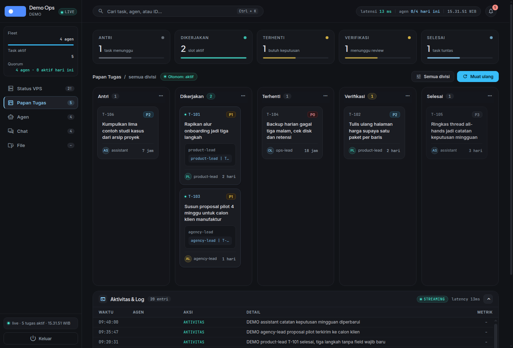
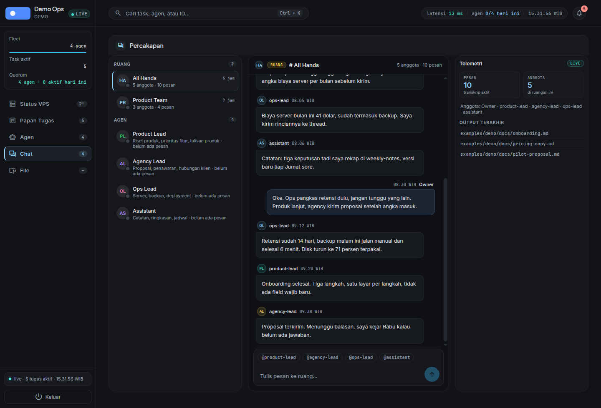

# hermes-agent-dashboard

A single-file operations board for a small fleet of [Hermes](https://hermes-agent.nousresearch.com/docs)
agents. One Python process serves a task board, per-agent and per-room chat,
file browsing, and host status (CPU, memory, disk, systemd units, containers,
listening services).

It is one file, `ops_board.py`, and it uses nothing outside the Python standard
library. No build step, no framework, no database, and no config file. Paths,
divisions, models, services, units and the host address are read from the
machine it runs on. A JSON config file exists only to override what the
detection found.





Both screenshots come from the demo data in `examples/demo`, not from a live
deployment.

## Run it

```sh
python3 ops_board.py --port 8899
```

The first start creates `.ops-board.secret` next to the detected workspace root,
mode 0600, holding one line of `user:password` with a random password. The path
is printed once. Read the file to get the password, then log in.

An optional config file is read from `$OPS_CONFIG`, else `./config.json`.
`config.example.json` lists the keys worth overriding.

## What is detected

| Value | Source |
| --- | --- |
| workspace root (`hq_dir`) | nearest ancestor of the script holding `shared/` and `reports/` or `NOTES.md` |
| task board, activity log, rooms, roster, brand | `shared/tasks.json`, `reports/activity-stream.log`, `shared/rooms`, `shared/roster.json`, `brand/` under that root |
| divisions | subfolders of `$HERMES_HOME/profiles` that contain `config.yaml`; `ops` when there are none |
| models | `model.default` in each profile's `config.yaml`; `default` when unreadable |
| listening services | `ss -ltnp` on loopback, `0.0.0.0` and `172.16.0.0/12`, plus `docker ps` when docker answers |
| units | `systemctl` and `systemctl --user`, running services only |
| host address | first non-loopback address from the socket table |
| page title | `$OPS_BOARD_NAME`, else `<hostname> Ops` |
| domain | the `Host` header of the request; nothing is stored |

`hermes` is looked up in `PATH`, `~/.local/bin`, `~/.hermes/bin`. When it is
missing the board still starts; chat replies with a message saying so.

## Security

Login is one `user:password` line in a 0600 file. Passwords are compared as
PBKDF2-SHA256 hashes with `hmac.compare_digest`, a failed attempt sleeps 0.4s,
and the error text never says which half was wrong. Sessions are HMAC-signed
cookies, `HttpOnly` and `SameSite=Lax`, `Secure` when the request arrives over
HTTPS. Ten failed logins per IP per five minutes get 429, and everything else
is capped at 120 requests per minute per IP. Every POST needs the CSRF token
that the page carries, checked against the session cookie. File browsing is
confined to whitelisted roots through `os.path.realpath`, and secrets, keys,
databases, `.git`, `id_rsa` and logs other than the activity log are never
served. Request bodies stop at 1 MB. Responses carry `nosniff`, `DENY`,
`no-referrer`, a CSP that allows nothing but this origin and Google Fonts, and
`no-store`.

The CSP allows the Google Fonts stylesheet and font files, which is where the
Material Symbols glyph set and the text faces come from. It is the only origin
outside this process that a page may load.

## Demo data

```sh
OPS_CONFIG=examples/config.demo.json python3 ops_board.py --port 8906
```

`demo: true` keeps the process away from the host: shell probes and outbound
HTTP checks are skipped and chat returns a canned line instead of spawning
Hermes. The demo secret file is created on first run.
